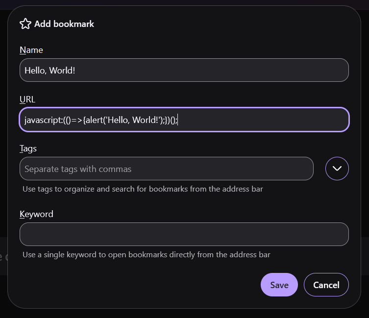
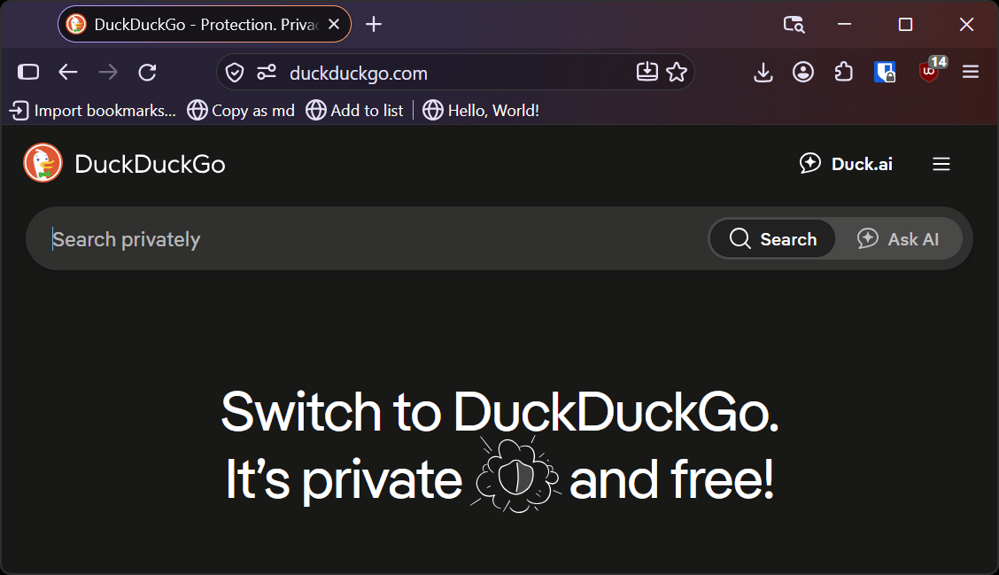

A bookmarklet is a browser bookmark that has a JavaScript code instead of a URL. Clicking it runs the code on currently active browser page.

## Anatomy

```
javascript:(()=>{ /* code */ })();
```

`javascript:` tells the browser to run the rest as code.

`(()=>{ ... })();` is an arrow function. It keeps variables out of the page's scope and returns nothing, so nothing on the page is replaced by a return.

> **Important**
> - it must be **one line**.
> - No `//` comments.
> - Use `;` between statements.
{: .prompt-warning }

## Example

Let's say I want to create a bookmarklet to show a pop-up that says "Hello, World":

I'll use JavaScript function `alert()` which is:

```javascript
alert('Hello, World!');
```

then I'll place it as an arrow function as explained above:
```javascript
javascript:(()=>{alert('Hello, World!');})();
```

Then I'll add a bookmark named `Hello, World` in my browser's bookmarks toolbar
{: width="753" height="649" .w-75 .normal }


Clicking on it will show the pop-up

{: width="1128" height="649" .w-75 .normal }

---

See: [[Obsidian QuickAdd URI bookmarklet]].